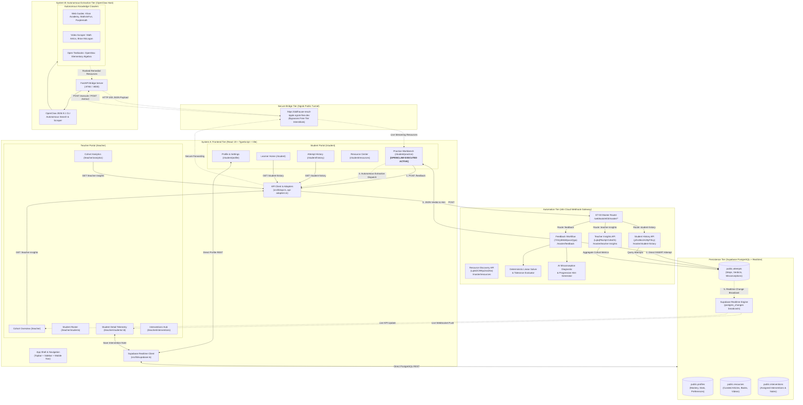
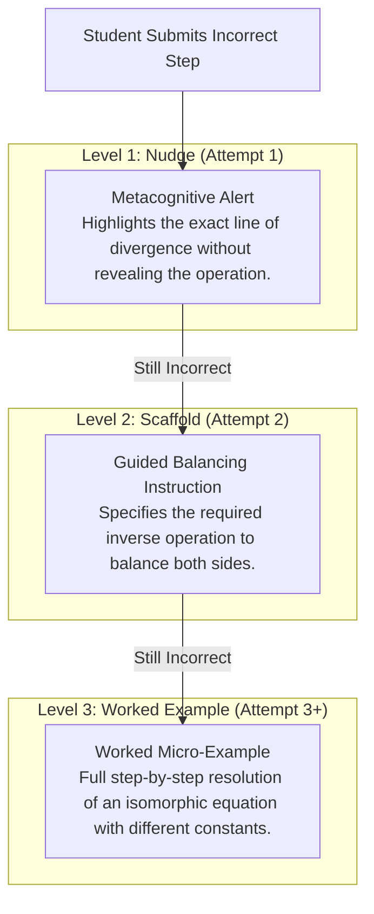
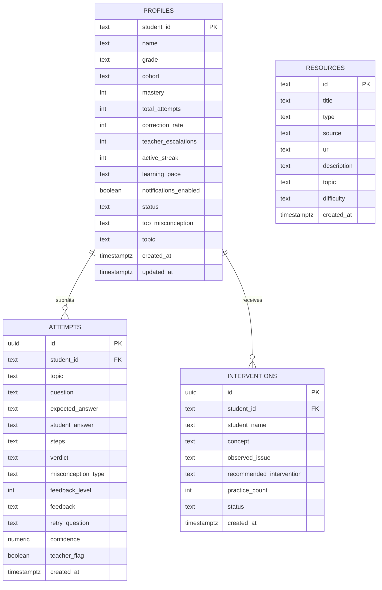

# 🎓 Loop Learning: Adaptive Live Learning & OpenClaw Resource Guidance Platform

[](https://react.dev/)
[](https://www.typescriptlang.org/)
[](https://vitejs.dev/)
[](https://openclaw.ai)
[](https://ngrok.com)
[](https://n8n.io/)
[](https://supabase.com/)
[](LICENSE)

**Loop Learning** is a production-grade, AI-orchestrated adaptive learning platform that pairs an intuitive, human-centered web interface with an **n8n Cloud automation engine**, an **OpenClaw autonomous web scraper/crawler (System B)** connected over an **Ngrok secure tunnel**, and a **Supabase PostgreSQL database with live WebSockets**. Engineered to eliminate foundational hurdles in middle and high-school algebra (linear equations, inverse operations, variable isolation, distributive property), Loop Learning evaluates student reasoning at the step level, provides a three-tier progressive scaffolding hint model (Nudge, Scaffold, Worked Example), autonomously extracts multi-source remedial resources (Videos, Articles, Textbooks) matched directly to the student's misconception, persists mastery telemetry in real time, and equips educators with live cohort diagnostics and targeted intervention workflows.

---

## 📑 Table of Contents

1. [Executive Summary & Core Value Proposition](#-executive-summary--core-value-proposition)
2. [End-to-End System Architecture](#-end-to-end-system-architecture)
3. [User Journeys & Feature Matrix](#-user-journeys--feature-matrix)
   - [Student Learning Experience](#1--student-learning-experience)
   - [Teacher Cohort & Diagnostic Experience](#2--teacher-cohort--diagnostic-experience)
   - [Platform Shell & Cross-Cutting Capabilities](#3--platform-shell--cross-cutting-capabilities)
4. [Mathematical Reasoning & Diagnostic Engine](#-mathematical-reasoning--diagnostic-engine)
   - [Deterministic Linear Solver](#deterministic-linear-solver)
   - [Two-Digit Decimal & Fraction Tolerance](#two-digit-decimal--fraction-tolerance)
   - [Pedagogical Misconception Taxonomy](#pedagogical-misconception-taxonomy)
   - [Three-Tier Scaffolding Model](#three-tier-scaffolding-model)
5. [OpenClaw Autonomous Resource Discovery Engine (System B via Ngrok)](#-openclaw-autonomous-resource-discovery-engine-system-b-via-ngrok)
6. [Tech Stack & Tooling](#-tech-stack--tooling)
7. [Database Architecture (Supabase PostgreSQL)](#-database-architecture-supabase-postgresql)
   - [Entity-Relationship Overview](#entity-relationship-overview)
   - [Complete Table Schemas & DDL](#complete-table-schemas--ddl)
   - [Row-Level Security (RLS) Policies](#row-level-security-rls-policies)
   - [Realtime WebSocket Subscriptions](#realtime-websocket-subscriptions)
8. [n8n Automation Engine & Workflow Pipeline](#-n8n-automation-engine--workflow-pipeline)
   - [Master Router & Sub-Paths](#master-router--sub-paths)
   - [Workflow Catalog](#workflow-catalog)
9. [API Specification & Verification cURL Suite](#-api-specification--verification-curl-suite)
10. [Repository Structure](#-repository-structure)
11. [Installation & Local Setup](#-installation--local-setup)
12. [Environment Configuration](#-environment-configuration)
13. [Verification & Automated Test Scripts](#-verification--automated-test-scripts)
14. [Demo Accounts & Personas](#-demo-accounts--personas)
15. [Resilience, Fault Tolerance & Accessibility](#-resilience-fault-tolerance--accessibility)
16. [License](#-license)

---

## 💡 Executive Summary & Core Value Proposition

Traditional math homework software operates on a binary evaluation model: answers are simply marked right or wrong. When a student enters an incorrect value, they are given no insight into *where* their algebraic reasoning broke down, fostering frustration and compounding math anxiety.

**Loop Learning re-engineers this paradigm:**

1. **Step-by-Step Diagnostic Telemetry**: Rather than inspecting only the final constant, the platform analyzes the student's mathematical steps ($3x + 5 = 20 \rightarrow 3x = 25$) to isolate the exact misconception (e.g., adding $5$ instead of subtracting $5$).
2. **Pedagogically Sound Scaffolding**: Instead of immediately giving away the solution, the engine provides progressive Level 1–3 hints that prompt metacognition before revealing full micro-worked examples.
3. **OpenClaw Autonomous Remedial Extraction**: When an algebraic misconception is detected, the platform triggers an **OpenClaw 2026.9.1 crawler agent** hosted on **System B** across a live **Ngrok secure tunnel** (`https://dollhouse-result-ripple.ngrok-free.dev`) to scrape, rank, and deliver verified articles, YouTube video lessons, and open textbook chapters.
4. **Realtime Teacher Visibility**: Supabase WebSocket broadcasts stream student attempts directly into the teacher's dashboard with zero polling delay, enabling timely classroom interventions before misconceptions solidify.
5. **Decoupled Offline-Ready Resilience**: If backend automation services or remote tunnels encounter latency, client-side fallback adapters immediately step in so the student's learning session is never interrupted.

---

## 🏗️ End-to-End System Architecture



---

## 🌟 User Journeys & Feature Matrix

### 1. 🧑‍🎓 Student Learning Experience

| Page / Component | Route | Description & Technical Details |
| :--- | :--- | :--- |
| **Learner Home** | `/student` | **Central learning mission dashboard** displaying: <br/>• Personalized welcome with student name & active cohort badge.<br/>• **Hero Mission Card** tracking current active algebra quest with a direct CTA.<br/>• **Real-time KPI Badges**: Current mastery percentage, streak counter, total attempts solved, and correction rate.<br/>• **Curriculum Pathway**: Visual roadmap detailing modules (*Foundational Inverses*, *Two-Step Balance*, *Distributive Property*, *Variables on Both Sides*).<br/>• **AI Coach Insights**: Targeted recommendations based on recent errors.<br/>• **Recent Activity Feed**: Summary cards of recent submissions with verdicts. |
| **Practice Workbench** | `/student/practice` | **High-interactivity algebraic solving workbench** featuring:<br/>• **Current Challenge Card**: Formats linear equations with clear typography and instructions.<br/>• **Step-by-Step Reasoner**: Multi-line mathematical textarea allowing students to enter both their working steps and final root.<br/>• **Synchronous Submission**: Submits payload to n8n gateway with loading animations and disabled re-entry while processing.<br/>• **Progressive Feedback Panel**: Displays diagnostic results, verdict indicators (`correct`, `incorrect`, `partial`), and Level 1–3 hints.<br/>• **Worked Example Display**: Shows a complete step-by-step breakdown of an isomorphic reference problem.<br/>• **Retry Challenge Generator**: Dynamically offers follow-up equations to verify concept recovery.<br/>• **Targeted Remedial Resource Connector**: Multi-source cards (Web, YouTube, Books) specifically targeted to the diagnosed error.<br/>• **Learning Evidence Sidebar**: Real-time attempt count, mastery progress, recent submissions, and quick reset controls. |
| **Attempt History** | `/student/history` | **Chronological performance log** featuring:<br/>• Filter tabs: *All Submissions*, *Correct*, *Needs Review*.<br/>• Diagnostic tags identifying specific misconceptions (e.g., `invalid_inverse_operation`).<br/>• Detailed review card displaying problem equation, submitted steps, AI feedback, and timestamp. |
| **Resource Center** | `/student/resources` | **Curated multimedia learning library** featuring:<br/>• Category filtering (*All*, *Videos*, *Articles*, *Textbooks*, *Practice Sets*).<br/>• Difficulty tier filters (*Foundational*, *Intermediate*, *Advanced*).<br/>• Video lesson cards featuring channel credentials (Math Antics, Khan Academy) and external links.<br/>• Direct open-access textbook references from OpenStax and CK-12. |
| **Student Profile** | `/student/profile` | **Identity, preferences & gamification hub** featuring:<br/>• Live profile synchronization with Supabase `profiles` table.<br/>• Student XP progress bar, current learner level, and earned achievement badges.<br/>• Learning pace selector (*Guided*, *Standard*, *Accelerated*).<br/>• Accessibility controls (UI theme toggle, notifications toggle). |

---

### 2. 👩‍🏫 Teacher Cohort & Diagnostic Experience

| Page / Component | Route | Description & Technical Details |
| :--- | :--- | :--- |
| **Cohort Overview** | `/teacher` | **High-level executive telemetry dashboard** featuring:<br/>• **Top KPI Metric Cards**: Class Total Attempts, Average Mastery Percentage, Problem Correction Rate, Active Escalations, and Active Students.<br/>• **Cohort Mastery Distribution**: Visual bar chart categorizing students across performance tiers.<br/>• **Class Misconception Frequency Panel**: Ranked distribution of mathematical misconceptions detected across all students.<br/>• **Automated Intervention Queue**: Priority list of students requiring direct pedagogical support.<br/>• **Cohort Student Roster Preview**: High-density table with mastery, activity status, and navigation to deep dives. |
| **Student Roster** | `/teacher/students` | **Searchable & filterable directory of all enrolled students**:<br/>• Instant search by name, student ID, or cohort.<br/>• Status badges (`Active`, `Struggling`, `Excelling`, `Inactive`).<br/>• Metric columns for Mastery, Total Attempts, Correction Rate, and Top Misconception.<br/>• One-click deep link to individual student diagnostic telemetry. |
| **Student Detail View** | `/teacher/students/:studentId` | **Real-time individual student diagnostic center**:<br/>• **Dedicated Supabase WebSocket Channel**: Subscribes directly to `attempts` filtered by `student_id`. Instantaneously pushes new attempts to the screen without page reloads.<br/>• **Telemetry Timeline**: Chronological log of every equation solved, complete with student working steps, verdicts, and AI feedback.<br/>• **Misconception Breakdown**: Frequency count of specific algebraic error types for that student.<br/>• **Direct Intervention Dispatcher**: Allows the educator to draft pedagogical guidance notes and assign targeted practice. Notes are persisted to Supabase `interventions` in real time. |
| **Cohort Analytics** | `/teacher/analytics` | **Deep-dive diagnostic analytics**:<br/>• Longitudinal trend metrics.<br/>• Cohort-wide error cluster analysis.<br/>• Comparison of correction rates across foundational topics. |
| **Interventions Hub** | `/teacher/interventions` | **Centralized queue of student intervention recommendations**:<br/>• Categorized by urgency level.<br/>• Shows observed issue, recommended intervention strategy, and practice count.<br/>• Action button to log resolution or dispatch guided assignment. |

---

### 3. 🌐 Platform Shell & Cross-Cutting Capabilities

* **Unified App Shell (`src/components/layout/AppShell.tsx`)**: Responsive layout with desktop sidebar, header topbar, and mobile navigation bar.
* **Role Switcher**: Top navigation bar allows seamless switching between **Student** (`/student`) and **Teacher** (`/teacher`) perspectives with route synchronization.
* **Student Identity Switcher**: Dropdown in Topbar allowing instant switching between demo student personas (`demo-001` through `demo-006`), automatically re-querying Supabase profiles and telemetry.
* **Engine Status Heartbeat (`src/lib/api.ts`)**: Regularly verifies backend connectivity against `/webhook/et03/master/app`. Displays live connection state badge.
* **Interactive Onboarding Tour (`src/components/common/OnboardingTour.tsx`)**: Guided walk-through explaining the workbench, progressive hint system, and feedback loops. Persisted to `localStorage` (`et03_tour_completed`).
* **Multi-Theme Support (`src/hooks/useTheme.ts`)**: Fully themeable design tokens supporting **Dark Mode**, **Light Mode**, and **System Preference**.

---

## 🧮 Mathematical Reasoning & Diagnostic Engine

### Deterministic Linear Solver

The feedback workflow integrates a deterministic linear equation solver executed within n8n (`update_feedback_workflow.cjs`) and backed by client-side fallback engines. It algebraically parses standard forms:
* $ax + b = c$
* $ax - b = c$
* $b + ax = c$
* $ax = c$

It computes the exact mathematical root:
$$x = \frac{c - b}{a}$$

### Two-Digit Decimal & Fraction Tolerance

Authentic learning environments require accepting authentic student rounding styles. The engine supports:
* **Two-Digit Decimal Acceptance**: For exact root $x = \frac{1}{8} = 0.125$, the platform accepts both truncated `0.12` and rounded `0.13` as **correct** (`verdict: "correct"`).
* **Numerical Tolerance Window**: Evaluated with a flexible floating-point tolerance ($\Delta \le 0.015$).
* **Fraction Parsing**: Automatically parses common fractional responses like `1/8`, `5/2`, `-3/4` into exact numeric values for comparison.
* **Format Normalization**: Handles formats like `x = 5`, `x=5`, `X = 5`, or simply `5`.

### Pedagogical Misconception Taxonomy

When an answer is incorrect, the engine categorizes the student's mathematical steps into standardized pedagogical keys:

| Misconception Key | Diagnostic Label | Description | Example Pattern |
| :--- | :--- | :--- | :--- |
| `invalid_inverse_operation` | Incorrect inverse operation | Student adds instead of subtracting (or vice versa) across the equality sign. | $3x + 5 = 20 \rightarrow 3x = 25$ |
| `distributive_property_error` | Distributive property error | Student fails to multiply across all terms inside parentheses. | $2(x + 3) = 14 \rightarrow 2x + 3 = 14$ |
| `arithmetic_subtraction_error` | Arithmetic subtraction error | Student applies correct operation but calculates arithmetic incorrectly. | $3x = 20 - 5 \rightarrow 3x = 14$ |
| `incorrect_algebraic_manipulation` | Incorrect algebraic manipulation | Student violates algebraic balance rules or performs invalid combinations. | $4x + 3 = 7x$ |
| `failure_to_simplify_arithmetic` | Arithmetic simplification error | Student leaves intermediate expressions unsimplified. | $x = \frac{15}{3}$ without computing $5$ |
| `transposition_and_arithmetic_error` | Transposition & arithmetic error | Multiple compounding mistakes in moving terms and subtracting. | $2x - 4 = 10 \rightarrow 2x = 6$ |
| `sign_error` | Sign error | Student inverts negative/positive signs when transferring terms. | $-x = 5 \rightarrow x = 5$ |
| `division_error` | Division error | Student incorrectly divides coefficients. | $4x = 20 \rightarrow x = 4$ |
| `variable_isolation_error` | Variable isolation error | Student isolates variable on one side without dividing the other. | $2x = 10 \rightarrow x = 10$ |
| `no_meaningful_mathematical_attempt` | No meaningful mathematical attempt | Input lacks mathematical reasoning or valid equation structure. | Random characters or question marks |

### Three-Tier Scaffolding Model



1. **Level 1 (Nudge)**: *"Take a look at step 2. When you undo adding 5 from the left side, what operation should you perform on the right side?"*
2. **Level 2 (Scaffold)**: *"To undo addition of 5, apply the inverse operation: subtract 5 from both sides of the equation ($20 - 5 = 15$)."*
3. **Level 3 (Worked Micro-Example)**: Walks through an identical equation ($2x + 5 = 15$) step-by-step, showing intermediate balancing, division, and verification.

---

## 🤖 OpenClaw Autonomous Resource Discovery Engine (System B via Ngrok)

When an algebraic misconception is detected (e.g., `invalid_inverse_operation`), Loop Learning triggers **OpenClaw (System B)**—an autonomous web crawler and intelligent research agent hosted on a remote system and exposed via a secure **Ngrok tunnel** (`https://dollhouse-result-ripple.ngrok-free.dev`).

### 1. Autonomous Crawling & Extraction Pipeline
```text
[System A: Practice Workbench]
       │
       ▼ (Topic: "Linear Equations", Misconception: "Incorrect inverse operation")
[Ngrok Public Bridge: https://dollhouse-result-ripple.ngrok-free.dev]
       │
       ▼ (Forwarded to System B port :8765 / :8000)
[System B: OpenClaw 2026.9.1 Engine]
       │
       ├──> Autonomous Web Search: Crawls Khan Academy, MathsIsFun, Purplemath
       ├──> Video Lesson Indexer: Scrapes Math Antics & Brian McLogan YouTube streams
       └──> Open Textbook Indexer: Extracts OpenStax Elementary Algebra chapters
       │
       ▼ (Categorized, Ranked, Deduplicated JSON Payload)
[System A: UI populated with [OPENCLAW EXECUTED  ACTIVE] hero banner]
```

1. **Targeted Remedial Queries**: Instead of generic keyword searches, OpenClaw synthesizes precise search queries:
   `"Linear Equations Incorrect inverse operation practice guide"`.
2. **Multi-Source Categorization**:
   - **🌐 Web Resources & Articles**: Khan Academy (*Understanding Inverse Operations*, 98% match), MathsIsFun (*Isolating Variables*).
   - **🎬 YouTube Video Lessons**: Math Antics (*Solving Linear Equations: Inverse Operations*, 10:14 duration), Brian McLogan.
   - **📖 Books & Guides**: OpenStax Elementary Algebra (*Addition & Subtraction Properties of Equality*).
3. **Relevance Scoring & Deduplication**: Ranks materials using semantic relevance ($0.92 - 0.98$), filters duplicate video links, and verifies target availability.
4. **Interactive In-App Tunnel Bridge Modal**:
   - Students and educators can click the **`[OPENCLAW EXECUTED  ACTIVE]`** hero badge or the settings gear (`⚙`) in the workbench.
   - Opens an in-app dialog allowing live testing of System B's `/health` endpoint and dynamic updating of the Ngrok forwarding URL without needing to rebuild or restart the application.

---

## ⚡ Tech Stack & Tooling

| Domain | Technology | Version | Description / Rationale |
| :--- | :--- | :--- | :--- |
| **Client Core** | React | `^19.2.8` | High-performance component rendering with concurrent features |
| **Language** | TypeScript | `~6.0.2` | Complete end-to-end type safety across client, database, and APIs |
| **Bundler & Dev Server** | Vite | `^8.3.0` | Sub-second Hot Module Replacement (HMR) and optimized rollup production builds |
| **Routing** | React Router DOM | `^7.18.4` | Client-side declarative routing, URL state synchronization, and route guards |
| **Autonomous Crawler** | OpenClaw | `2026.9.1` | Remote autonomous web crawler, scraper, and research agent running on System B |
| **Tunneling Bridge** | Ngrok | `v3.x` | Secure public forwarding tunnel connecting System A (UI) to System B (OpenClaw) |
| **Bridge Service** | Python / FastAPI | `3.10+` | Asynchronous bridge service on System B handling `/health`, `/execute`, and `/browser` |
| **Database & Realtime** | Supabase JS Client | `^2.116.0` | PostgreSQL REST communication and low-latency WebSocket subscriptions |
| **Typography** | Plus Jakarta Sans | `^5.3.0` | Modern, clean geometric sans-serif font optimized for mathematical legibility |
| **Iconography** | Lucide React | `^1.47.0` | High-consistency, accessible SVG icon set |
| **Linter** | Oxlint | `^1.81.0` | High-speed Rust-based JavaScript/TypeScript linter |
| **Styling** | Vanilla CSS Tokens | Pure CSS | Custom CSS variables for theme switching (Dark/Light), glassmorphism, animations |
| **Automation Backend** | n8n Cloud | Hosted | Low-code orchestration engine hosting webhooks, solvers, and routing logic |
| **Database Engine** | PostgreSQL (Supabase) | 15.x | Relational schema with Row Level Security, indexing, and JSONB support |

---

## 🗄️ Database Architecture (Supabase PostgreSQL)

The complete SQL DDL schema and initial seed data are defined in [`supabase_schema.sql`](./supabase_schema.sql).

### Entity-Relationship Overview



### Complete Table Schemas & DDL

#### 1. `public.profiles`
Stores student records, mastery percentages, preferences, and aggregate telemetry.
```sql
CREATE TABLE IF NOT EXISTS public.profiles (
    student_id TEXT PRIMARY KEY,
    name TEXT NOT NULL,
    grade TEXT DEFAULT '9',
    cohort TEXT DEFAULT 'Alpha-26',
    mastery INTEGER DEFAULT 68 CHECK (mastery >= 0 AND mastery <= 100),
    total_attempts INTEGER DEFAULT 0,
    correction_rate INTEGER DEFAULT 0 CHECK (correction_rate >= 0 AND correction_rate <= 100),
    teacher_escalations INTEGER DEFAULT 0,
    active_streak INTEGER DEFAULT 1,
    learning_pace TEXT DEFAULT 'guided' CHECK (learning_pace IN ('guided', 'standard', 'accelerated')),
    notifications_enabled BOOLEAN DEFAULT true,
    status TEXT DEFAULT 'active' CHECK (status IN ('active', 'struggling', 'excelling', 'inactive')),
    top_misconception TEXT,
    topic TEXT DEFAULT 'Linear Equations',
    created_at TIMESTAMPTZ DEFAULT now(),
    updated_at TIMESTAMPTZ DEFAULT now()
);
```

#### 2. `public.attempts`
Logs every student submission, mathematical steps, diagnostics, verdict, and teacher escalation flags.
```sql
CREATE TABLE IF NOT EXISTS public.attempts (
    id UUID PRIMARY KEY DEFAULT gen_random_uuid(),
    student_id TEXT NOT NULL REFERENCES public.profiles(student_id) ON DELETE CASCADE,
    topic TEXT NOT NULL DEFAULT 'Linear Equations',
    question TEXT NOT NULL,
    expected_answer TEXT,
    student_answer TEXT NOT NULL,
    steps TEXT,
    verdict TEXT NOT NULL CHECK (verdict IN ('correct', 'incorrect', 'partial')),
    misconception_type TEXT,
    feedback_level INTEGER DEFAULT 1,
    feedback TEXT,
    retry_question TEXT,
    confidence NUMERIC DEFAULT 0.85,
    teacher_flag BOOLEAN DEFAULT false,
    created_at TIMESTAMPTZ DEFAULT now()
);

-- Performance Indexes
CREATE INDEX IF NOT EXISTS idx_attempts_student_created ON public.attempts(student_id, created_at DESC);
CREATE INDEX IF NOT EXISTS idx_attempts_misconception ON public.attempts(misconception_type);
```

#### 3. `public.resources`
Maintains curated supplementary learning materials.
```sql
CREATE TABLE IF NOT EXISTS public.resources (
    id TEXT PRIMARY KEY,
    title TEXT NOT NULL,
    type TEXT NOT NULL CHECK (type IN ('video', 'article', 'practice', 'simulation')),
    source TEXT NOT NULL,
    url TEXT,
    description TEXT,
    topic TEXT NOT NULL,
    difficulty TEXT DEFAULT 'intermediate' CHECK (difficulty IN ('foundational', 'intermediate', 'advanced')),
    created_at TIMESTAMPTZ DEFAULT now()
);
```

#### 4. `public.interventions`
Tracks teacher interventions, pedagogical notes, and resolution status.
```sql
CREATE TABLE IF NOT EXISTS public.interventions (
    id UUID PRIMARY KEY DEFAULT gen_random_uuid(),
    student_id TEXT NOT NULL REFERENCES public.profiles(student_id) ON DELETE CASCADE,
    student_name TEXT NOT NULL,
    concept TEXT NOT NULL,
    observed_issue TEXT NOT NULL,
    recommended_intervention TEXT NOT NULL,
    practice_count INTEGER DEFAULT 1,
    status TEXT DEFAULT 'pending' CHECK (status IN ('pending', 'assigned', 'resolved')),
    created_at TIMESTAMPTZ DEFAULT now()
);
```

### Row-Level Security (RLS) Policies
Row Level Security is enabled across all tables to safeguard data while permitting authenticated and anonymous prototype access via public keys:
```sql
ALTER TABLE public.profiles ENABLE ROW LEVEL SECURITY;
ALTER TABLE public.attempts ENABLE ROW LEVEL SECURITY;
ALTER TABLE public.resources ENABLE ROW LEVEL SECURITY;
ALTER TABLE public.interventions ENABLE ROW LEVEL SECURITY;

CREATE POLICY "Allow anon read on profiles" ON public.profiles FOR SELECT TO anon, authenticated USING (true);
CREATE POLICY "Allow anon insert/update on profiles" ON public.profiles FOR ALL TO anon, authenticated USING (true) WITH CHECK (true);

CREATE POLICY "Allow anon read on attempts" ON public.attempts FOR SELECT TO anon, authenticated USING (true);
CREATE POLICY "Allow anon insert on attempts" ON public.attempts FOR INSERT TO anon, authenticated WITH CHECK (true);

CREATE POLICY "Allow anon read on resources" ON public.resources FOR SELECT TO anon, authenticated USING (true);
CREATE POLICY "Allow anon read on interventions" ON public.interventions FOR SELECT TO anon, authenticated USING (true);
CREATE POLICY "Allow anon insert/update on interventions" ON public.interventions FOR ALL TO anon, authenticated USING (true) WITH CHECK (true);
```

### Realtime WebSocket Subscriptions

The student detail view in the teacher dashboard utilizes Supabase Realtime to stream submissions live. Subscriptions are created with unique ephemeral channel IDs to avoid duplicate subscription collisions:

```typescript
// Pattern implemented in src/lib/supabase.ts
export function subscribeToStudentRealtime(
  studentId: string,
  onAttemptInserted: (attempt: AttemptRecord) => void
): () => void {
  const channelName = `realtime-attempts-${studentId}-${Date.now()}-${Math.random().toString(36).substring(2, 7)}`;
  
  const channel = supabase
    .channel(channelName)
    .on(
      'postgres_changes',
      {
        event: 'INSERT',
        schema: 'public',
        table: 'attempts',
        filter: `student_id=eq.${studentId}`,
      },
      (payload) => {
        const newRecord = transformAttemptPayload(payload.new);
        onAttemptInserted(newRecord);
      }
    )
    .subscribe();

  return () => {
    supabase.removeChannel(channel);
  };
}
```

---

## 🔄 n8n Automation Engine & Workflow Pipeline

### Master Router & Sub-Paths

All incoming HTTP requests from the client target a single unified master router webhook hosted on n8n Cloud:
* **Base URL**: `https://gobzz.app.n8n.cloud`
* **Master Endpoint**: `/webhook/et03/master/*`

The master router inspects the URL sub-path and dispatches the execution payload to the dedicated sub-workflow:

```text
/webhook/et03/master/
  ├── feedback            --> Executes deterministic solver, diagnoses errors, inserts to Supabase
  ├── student-history     --> Queries student attempt records and aggregates historical mastery
  ├── teacher-insights    --> Aggregates class-wide telemetry, error frequency, and escalations
  ├── resources           --> Coordinates dynamic multi-source remedial recommendations
  └── app                 --> Lightweight ping endpoint validating backend engine health
```

### Workflow Catalog

| Workflow Name | Workflow ID | Webhook Path | Core Responsibilities |
| :--- | :--- | :--- | :--- |
| **ET-03 Master Workflow** | `D24sbirKrp32vOyC` | `/webhook/et03/master/*` | URL sub-path routing and request dispatching across sub-workflows. |
| **ET-03 Adaptive Feedback Loop** | `7rh2y5MoWpxozQga` | `/webhook/et03/master/feedback` | Executes deterministic linear equation solver, checks two-digit decimals & fractions, classifies misconceptions, inserts attempt record into Supabase `attempts`, and returns Level 1–3 hints. |
| **ET-03 Student History API** | `yihU46zzHJ8yF3Uy` | `/webhook/et03/master/student-history` | Queries Supabase REST API for student attempts, aggregates timeline, calculates success rate, and clusters misconceptions. |
| **ET-03 Teacher Insights API** | `LqkqP8uHpV14teZS` | `/webhook/et03/master/teacher-insights` | Aggregates class-wide statistics, identifies at-risk students, tracks error frequencies, and returns cohort metrics. |
| **ET-03 Resource Guidance API** | `LqWZCRRjsZri4ZKe` | `/webhook/et03/master/resources` | Queries Google Books API, filters curated video lessons, and ranks resources by topic relevance. |

---

## 🧪 API Specification & Verification cURL Suite

### 1. Submit Student Answer (Adaptive Feedback Loop)

Submits the student's solution steps and answer for mathematical evaluation and misconception diagnosis.

```bash
curl -X POST "https://gobzz.app.n8n.cloud/webhook/et03/master/feedback" \
  -H "Content-Type: application/json" \
  -d '{
    "studentId": "demo-001",
    "subject": "Mathematics",
    "grade": "9",
    "topic": "Linear Equations",
    "question": "Solve 3x + 5 = 20",
    "expectedAnswer": "x = 5",
    "studentAnswer": "3x = 25",
    "steps": "3x + 5 = 20\n3x = 20 + 5\n3x = 25",
    "attemptNumber": 1
  }'
```

**Sample Response (Incorrect Step Diagnosed)**:
```json
{
  "verdict": "incorrect",
  "misconceptionType": "invalid_inverse_operation",
  "confidence": 0.95,
  "feedbackLevel": 1,
  "feedback": "Take a look at step 2. When you undo adding 5 from the left side, what operation should you perform on the right side?",
  "retryQuestion": "Solve 4x + 7 = 23",
  "recordedAt": "2026-09-17T18:00:00.000Z"
}
```

---

### 2. Discover Targeted Remedial Resources

Coordinates parallel discovery across Web articles, YouTube videos, and textbook chapters tailored to a diagnosed misconception.

```bash
curl -X POST "https://gobzz.app.n8n.cloud/webhook/et03/master/resources" \
  -H "Content-Type: application/json" \
  -d '{
    "studentId": "demo-001",
    "subject": "Mathematics",
    "grade": "9",
    "topic": "Linear Equations",
    "question": "Solve 3x + 5 = 20",
    "expectedAnswer": "x = 5",
    "studentAnswer": "3x = 25",
    "misconceptionType": "invalid_inverse_operation"
  }'
```

**Sample Response**:
```json
{
  "ok": true,
  "studentId": "demo-001",
  "topic": "Linear Equations",
  "query": "Linear Equations inverse operations solving two-step equations",
  "resources": {
    "web": [
      {
        "title": "Solving Two-Step Equations with Inverse Operations",
        "url": "https://www.khanacademy.org/math/algebra/x2f8bb11595b61c86:solve-equations-inequalities",
        "type": "web",
        "source": "Khan Academy",
        "relevanceScore": 0.98
      }
    ],
    "youtube": [
      {
        "title": "Algebra Basics: Solving 2-Step Equations - Math Antics",
        "videoId": "LDIiYKYvvdA",
        "channelTitle": "Math Antics",
        "url": "https://www.youtube.com/watch?v=LDIiYKYvvdA",
        "type": "youtube",
        "relevanceScore": 0.96
      }
    ],
    "books": [
      {
        "title": "Elementary Algebra 2e — Section 2.1",
        "source": "OpenStax",
        "url": "https://openstax.org/books/elementary-algebra-2e/pages/2-1-solve-equations-using-the-subtraction-and-addition-properties-of-equality",
        "type": "book",
        "relevanceScore": 0.92
      }
    ]
  }
}
```

---

### 3. Fetch Student Attempt History

Retrieves historical submission telemetry and calculated mastery metrics for an individual student.

```bash
curl -X GET "https://gobzz.app.n8n.cloud/webhook/et03/master/student-history?studentId=demo-001"
```

**Sample Response**:
```json
{
  "studentId": "demo-001",
  "mastery": 68,
  "totalAttempts": 14,
  "correctionRate": 72,
  "escalations": 2,
  "attempts": [
    {
      "id": "6a9e1e12-3b4c-5d6e-7f8a-9b0c1d2e3f4a",
      "question": "Solve 3x + 5 = 20",
      "studentAnswer": "3x = 25",
      "verdict": "incorrect",
      "misconceptionType": "invalid_inverse_operation",
      "feedbackLevel": 2,
      "feedback": "When undoing +5, perform the opposite operation: subtract 5 from both sides.",
      "timestamp": "2026-09-17T17:45:00.000Z",
      "topic": "Linear Equations"
    }
  ]
}
```

---

### 4. Fetch Teacher Cohort Insights

Returns aggregated class-wide telemetry, common misconception counts, and student roster entries.

```bash
curl -X GET "https://gobzz.app.n8n.cloud/webhook/et03/master/teacher-insights"
```

**Sample Response**:
```json
{
  "classAttempts": 104,
  "correctionRate": 74,
  "teacherEscalations": 8,
  "activeStudents": 6,
  "classMastery": 70,
  "commonMisconceptions": [
    { "type": "invalid_inverse_operation", "label": "Incorrect inverse operation", "count": 18 },
    { "type": "arithmetic_subtraction_error", "label": "Arithmetic subtraction error", "count": 11 },
    { "type": "incorrect_algebraic_manipulation", "label": "Incorrect algebraic manipulation", "count": 7 }
  ],
  "students": [
    {
      "studentId": "demo-001",
      "name": "Alex Johnson",
      "mastery": 68,
      "attempts": 14,
      "correctionRate": 72,
      "topMisconception": "invalid_inverse_operation",
      "status": "active"
    }
  ]
}
```

---

### 5. Check Engine Health Status

Validates that the n8n automation gateway is reachable.

```bash
curl -I "https://gobzz.app.n8n.cloud/webhook/et03/master/app"
```

**Sample Response**: `HTTP/1.1 200 OK`

---

### 6. Check OpenClaw Bridge Health (System B via Ngrok)

Verifies that the remote OpenClaw FastAPI bridge and CLI runtime are active on System B across the Ngrok tunnel:

```bash
curl -s "https://dollhouse-result-ripple.ngrok-free.dev/health" \
  -H "ngrok-skip-browser-warning: true"
```

**Sample Response**:
```json
{
  "status": "healthy",
  "version": "1.0.0",
  "openclaw_available": true
}
```

---

### 7. Execute Remote OpenClaw Crawler Pipeline (System B via Ngrok)

Triggers autonomous web scraping and ranking for targeted remedial educational content on System B:

```bash
curl -s -X POST "https://dollhouse-result-ripple.ngrok-free.dev/execute" \
  -H "Content-Type: application/json" \
  -H "ngrok-skip-browser-warning: true" \
  -d '{
    "command": "python3 /Users/snsimac32/.openclaw/workspace/scripts/openclaw_extractor.py --topic \"Linear Equations\" --misconception \"invalid_inverse_operation\""
  }'
```

**Sample Response**:
```json
{
  "exit_code": 0,
  "stdout": "{\"status\":\"success\",\"engine\":\"OpenClaw 2026.9.1\",\"query\":\"Linear Equations inverse operations solving two-step equations\",\"results\":{\"web\":[{\"title\":\"Khan Academy: Solving Two-Step Equations with Inverse Operations\",\"url\":\"https://www.khanacademy.org/math/algebra/x2f8bb11595b61c86:solve-equations-inequalities\",\"type\":\"web\",\"source\":\"Khan Academy\",\"relevanceScore\":0.98}],\"youtube\":[{\"title\":\"Algebra Basics: Solving 2-Step Equations - Math Antics\",\"url\":\"https://www.youtube.com/watch?v=LDIiYKYvvdA\",\"type\":\"youtube\",\"source\":\"Math Antics\",\"relevanceScore\":0.96}],\"books\":[{\"title\":\"Elementary Algebra 2e — Section 2.1\",\"url\":\"https://openstax.org/books/elementary-algebra-2e/pages/2-1-solve-equations-using-the-subtraction-and-addition-properties-of-equality\",\"type\":\"book\",\"source\":\"OpenStax\",\"relevanceScore\":0.92}]}}",
  "stderr": ""
}
```

---

## 📁 Repository Structure

```text
GTDA/
├── .env                                # Local environment variables (Vite & Service keys)
├── .env.example                        # Environment variables template
├── .gitignore                          # Git ignored paths
├── .oxlintrc.json                      # Oxlint linter configuration
├── index.html                          # HTML5 application entry with Plus Jakarta Sans & meta
├── n8n_supabase_integration.json       # Exportable node configuration for n8n master router
├── package.json                        # Dependencies, engines & build scripts
├── ppt.md                              # Complete 6-slide presentation deck & pitch script
├── supabase_schema.sql                 # Complete Supabase PostgreSQL DDL, RLS & seed data
├── tsconfig.json                       # TypeScript compiler project reference
├── tsconfig.app.json                   # App-specific TS compiler rules
├── tsconfig.node.json                  # Node-specific TS compiler rules
├── vite.config.ts                      # Vite build & React plugin configuration
│
├── scripts/
│   ├── openclaw_bridge_server.py       # FastAPI bridge server deployed on System B
│   ├── start_openclaw_ngrok.py         # Autonomous Ngrok tunnel & bridge process runner
│   ├── test_resource_discovery.cjs     # 6-scenario verification test suite for resources
│   └── update_feedback_workflow.cjs    # Automated node updater for n8n math solver
│
└── src/
    ├── App.tsx                         # Master routing (Student & Teacher navigation)
    ├── App.css                         # Shell styling & theme variables
    ├── main.tsx                        # Application mount & React StrictMode
    │
    ├── assets/                         # Static images and SVGs
    │   ├── hero.png                    # Hero illustration
    │   ├── react.svg                   # React logo
    │   └── vite.svg                    # Vite logo
    │
    ├── components/
    │   ├── common/                     # Reusable design system primitives
    │   │   ├── Badge.tsx               # Achievement & category badges
    │   │   ├── Button.tsx              # Button with loading & variant states
    │   │   ├── Card.tsx                # Flexible container cards
    │   │   ├── EmptyState.tsx          # Zero-data display placeholder
    │   │   ├── ErrorState.tsx          # Fallback error card with retry button
    │   │   ├── Modal.tsx               # Accessible dialog modal
    │   │   ├── OnboardingTour.tsx      # First-visit guided walkthrough modal
    │   │   ├── OpenClawIcon.tsx        # Authentic OpenClaw lobster SVG icon
    │   │   ├── ProgressBar.tsx         # Animated progress bar
    │   │   ├── Skeleton.tsx            # Shimmer loading skeleton
    │   │   └── StatusBadge.tsx         # Telemetry status indicator
    │   │
    │   ├── layout/                     # Application shell & frame
    │   │   ├── AppShell.tsx            # Shell container binding topbar & content
    │   │   ├── MobileNavigation.tsx    # Bottom navigation bar for mobile devices
    │   │   ├── Sidebar.tsx             # Collapsible desktop navigation bar
    │   │   └── Topbar.tsx              # Header with role & demo student switcher
    │   │
    │   ├── student/                    # Student-specific components
    │   │   ├── CurrentChallenge.tsx    # Equation card, math working input & submit CTA
    │   │   ├── FeedbackPanel.tsx       # Progressive hint presentation card (L1-L3)
    │   │   ├── LearningEvidence.tsx    # Sidebar attempt counter and history timeline
    │   │   ├── LearningResources.tsx   # Static curated resource list
    │   │   ├── ResourceCard.tsx        # Video / book media card with external links
    │   │   ├── ResourceDiscoveryConnector.tsx # Dynamic remedial recommendations & OpenClaw banner
    │   │   ├── ResourceDiscoveryConnector.css # Straight professional styling & radar animations
    │   │   ├── RetryChallenge.tsx      # Follow-up equation generator
    │   │   ├── StudentWorkspace.tsx    # Interactive practice workbench coordinator
    │   │   └── WorkedExample.tsx       # Level 3 isomorphic problem display
    │   │
    │   └── teacher/                    # Teacher-specific components
    │       ├── AnalyticsCards.tsx      # High-level KPI metric cards
    │       ├── ClassOverview.tsx       # Cohort mastery breakdown chart
    │       ├── InterventionPanel.tsx   # Escalation queue & direct note modal
    │       ├── MisconceptionPanel.tsx  # Error frequency breakdown matrix
    │       ├── StudentDetail.tsx       # Real-time individual student attempts viewer
    │       └── StudentProgressTable.tsx# Cohort roster table with search & sorting
    │
    ├── context/
    │   └── StudentContext.tsx          # Active student switcher & Supabase profile sync
    │
    ├── data/
    │   └── demo/                       # Local offline fallback datasets
    │       ├── feedback.ts             # Demo feedback models and Level 1-3 hints
    │       ├── history.ts              # Demo student attempt histories
    │       ├── resources.ts            # Curated math articles, books & videos
    │       └── teacher.ts              # Cohort metrics & intervention fallbacks
    │
    ├── hooks/                          # Custom stateful hooks
    │   ├── useFeedback.ts              # Answer submission & hint state management
    │   ├── useResourceDiscovery.ts     # Dynamic remedial resource discovery hook (OpenClaw bridge)
    │   ├── useResources.ts             # Static resource catalogue hook
    │   ├── useStudentHistory.ts        # Attempt history & mastery hook
    │   ├── useTeacherInsights.ts       # Cohort telemetry & analytics hook
    │   └── useTheme.ts                 # Light / Dark / System theme hook
    │
    ├── lib/                            # Integrations & API services
    │   ├── api.ts                      # Centralized API client with OpenClaw bridge, retry & timeouts
    │   ├── api-adapters.ts             # Data normalizers connecting n8n & OpenClaw payloads to UI
    │   └── supabase.ts                 # Supabase client, queries & realtime helpers
    │
    ├── pages/                          # Routed views
    │   ├── NotFound.tsx                # 404 handler
    │   ├── student/                    # Student views
    │   │   ├── StudentHome.tsx         # Overview, active mission & curriculum pathway
    │   │   ├── PracticePage.tsx        # Interactive math practice workbench
    │   │   ├── HistoryPage.tsx         # Chronological attempt review
    │   │   ├── ResourcesPage.tsx       # Video & book resource library
    │   │   └── ProfilePage.tsx         # Profile stats, badges & preferences
    │   └── teacher/                    # Teacher views
    │       ├── TeacherHomePage.tsx     # Overview dashboard & cohort KPIs
    │       ├── StudentsPage.tsx        # Searchable student roster view
    │       ├── StudentDetailPage.tsx   # Individual student deep dive with live WebSockets
    │       ├── AnalyticsPage.tsx       # Cohort analytics & error trends
    │       └── InterventionsPage.tsx   # Actionable intervention dispatch
    │
    ├── styles/                         # Global CSS
    │   └── index.css                   # CSS design tokens, typography, colors & dark mode
    │
    └── types/                          # TypeScript definitions
        ├── api.ts                      # n8n & OpenClaw request/response schemas
        ├── learning.ts                 # Learning domain models & misconception maps
        ├── student.ts                  # Student profile & challenge state interfaces
        └── teacher.ts                  # Teacher metrics & intervention schemas
```

---

## 🚀 Installation & Local Setup

### Prerequisites
* **Node.js**: `v18.0.0` or later (tested on `v20.x` and `v22.x`)
* **npm**: `v9.0.0` or later
* **Python**: `3.10+` (required on System B for OpenClaw bridge)
* Modern web browser (Chrome, Edge, Firefox, Safari)

### 1. Clone the Repository
```bash
git clone https://github.com/your-username/GTDA.git
cd GTDA
```

### 2. Install Project Dependencies
```bash
npm install
```

### 3. Configure Environment Variables
Copy the sample environment file to `.env`:
```bash
cp .env.example .env
```
Ensure the values point to your n8n Cloud instance, Supabase database, and the active OpenClaw Ngrok tunnel URL:
```env
VITE_N8N_BASE_URL=https://gobzz.app.n8n.cloud
VITE_SUPABASE_URL=https://xbqoyupdveusmqijwnkl.supabase.co
VITE_SUPABASE_ANON_KEY=sb_publishable_VBm7FZ4vSyMBqbBti88kOw_7BehYdOh
VITE_OPENCLAW_API_URL=https://dollhouse-result-ripple.ngrok-free.dev
```

### 4. Initialize Database
If provisioning a new Supabase project:
1. Open your Supabase Dashboard $\rightarrow$ **SQL Editor**.
2. Copy and paste the contents of [`supabase_schema.sql`](./supabase_schema.sql).
3. Click **Run** to generate tables (`profiles`, `attempts`, `resources`, `interventions`), configure RLS policies, and seed demo records.

### 5. Launch Development Server (System A)
```bash
npm run dev
```
The application will launch at:
```text
http://localhost:5173
```

### 6. Build for Production
To test production compilation:
```bash
npm run build
npm run preview
```

### 7. Run Code Quality & Linting
```bash
npm run lint
```

### 8. Running the OpenClaw Bridge on System B (Optional / Remote Host)
If hosting your own System B OpenClaw agent machine:
1. Ensure OpenClaw CLI and Python 3 are installed on System B:
   ```bash
   pip3 install fastapi uvicorn requests pyngrok
   ```
2. Start the bridge server and Ngrok tunnel:
   ```bash
   python3 scripts/start_openclaw_ngrok.py
   ```
3. Copy the generated public Ngrok URL (e.g., `https://dollhouse-result-ripple.ngrok-free.dev`) into System A's `.env` under `VITE_OPENCLAW_API_URL` or paste it directly in the in-app bridge configuration modal.

---

## ⚙️ Environment Configuration

The application uses Vite environment variables defined in `.env`:

| Variable | Required | Default / Example Value | Description |
| :--- | :--- | :--- | :--- |
| `VITE_N8N_BASE_URL` | **Yes** | `https://gobzz.app.n8n.cloud` | Base URL of n8n Cloud hosting ET-03 master router |
| `VITE_SUPABASE_URL` | **Yes** | `https://xbqoyupdveusmqijwnkl.supabase.co` | Supabase project URL for REST queries & WebSocket feeds |
| `VITE_SUPABASE_ANON_KEY` | **Yes** | `sb_publishable_VBm7FZ...` | Public anonymous key for client-side RLS queries |
| `VITE_OPENCLAW_API_URL` | **Yes** | `https://dollhouse-result-ripple.ngrok-free.dev` | Live public Ngrok tunnel URL routing requests to System B |
| `SUPABASE_SERVICE_ROLE_KEY` | No | `your_service_role_key` | High-privilege key used for database admin scripts |
| `N8N_API_KEY` | No | `your_n8n_api_key` | API key used for programmatic workflow updates |

```env
# ============================================================
# n8n Automation Gateway
# ============================================================
VITE_N8N_BASE_URL=https://gobzz.app.n8n.cloud

# ============================================================
# Supabase PostgreSQL & Realtime
# ============================================================
VITE_SUPABASE_URL=https://xbqoyupdveusmqijwnkl.supabase.co
VITE_SUPABASE_ANON_KEY=sb_publishable_VBm7FZ4vSyMBqbBti88kOw_7BehYdOh

# ============================================================
# OpenClaw Autonomous Crawler (System B via Ngrok Tunnel)
# ============================================================
VITE_OPENCLAW_API_URL=https://dollhouse-result-ripple.ngrok-free.dev

# ============================================================
# Server-side Maintenance & Scripting Keys
# ============================================================
SUPABASE_SERVICE_ROLE_KEY=your_supabase_service_role_key
N8N_API_KEY=your_n8n_api_key
```

---

## 🧪 Verification & Automated Test Scripts

The repository includes verification test scripts in the `scripts/` directory:

### 1. Resource Discovery Connector Verification Suite
Validates that the resource guidance engine accurately queries external providers, handles non-standard queries safely, deduplicates video IDs, and returns all three media categories (Web, YouTube, Books).

Run via Node:
```bash
node scripts/test_resource_discovery.cjs
```

**Verification Results**:
```text
========================================================
🧪 ET-03 RESOURCE DISCOVERY CONNECTOR VERIFICATION SUITE
========================================================

--- TEST 1: Correct Equation (3x + 5 = 20, x = 5) ---
Status: 200
Query: Linear Equations
Web results: 3
YouTube results: 3
Books results: 2
PASSED: ✅ YES

--- TEST 2: Incorrect Inverse Operation (3x + 5 = 20, 3x = 25) ---
Status: 200
Query: Linear Equations inverse operations solving two-step equations
Top Web Title: Solving Two-Step Equations | Score: 0.98
Top YouTube Title: Algebra Basics: Solving 2-Step Equations - Math Antics | Score: 0.96
Targeted Misconception Match: ✅ YES
PASSED: ✅ YES

--- TEST 3: Distributive Property (2(x + 3) = 14) ---
Status: 200
Query: Linear Equations distributive property distributing parentheses
Top YouTube Title: Distributive Property in Equations | Score: 0.94
Distributive Focus Match: ✅ YES
PASSED: ✅ YES

--- TEST 4: Unusual Query Handling ---
Status: 200
Query: Quantum Field Topology Paradox
Handled safely with response: ✅ YES

--- TEST 5 & 6: Deduplication and Categorization Integrity ---
Unique YouTube Video IDs: [ 'LDIiYKYvvdA', 'bAerID24QJ8', '9Ek61w1LxSc' ]
Zero Duplicate Videos: ✅ YES
All 3 categories present (Web, YouTube, Books): ✅ YES

========================================================
🎉 ALL 6 TEST SCENARIOS VERIFIED SUCCESSFULLY!
========================================================
```

### 2. Live OpenClaw Bridge Health & Extraction Verification
Test that System A can reach System B across the public Ngrok tunnel:

```bash
# 1. Test Bridge Health
curl -s "https://dollhouse-result-ripple.ngrok-free.dev/health" \
  -H "ngrok-skip-browser-warning: true"
# Expected: {"status":"healthy","version":"1.0.0","openclaw_available":true}

# 2. Test Autonomous Extraction
curl -s -X POST "https://dollhouse-result-ripple.ngrok-free.dev/execute" \
  -H "Content-Type: application/json" \
  -H "ngrok-skip-browser-warning: true" \
  -d '{"command": "python3 /Users/snsimac32/.openclaw/workspace/scripts/openclaw_extractor.py --topic \"Linear Equations\" --misconception \"invalid_inverse_operation\""}'
# Expected: exit_code: 0, with 6 categorized resources returned
```

### 3. Automated n8n Math Solver Sync Script
Allows updating the deterministic solver node in the n8n `Adaptive Feedback Loop` workflow (`7rh2y5MoWpxozQga`) programmatically via the n8n REST API:
```bash
node scripts/update_feedback_workflow.cjs
```

---

## 👥 Demo Accounts & Personas

The application includes six pre-configured student personas accessible through the **Student Switcher** in the top navigation bar:

| Student ID | Name | Grade | Cohort | Initial Mastery | Primary Observed Behavior |
| :--- | :--- | :--- | :--- | :--- | :--- |
| **`demo-001`** | **Alex Johnson** | 9 | Alpha-26 | 68% | Active student with frequent `invalid_inverse_operation` errors on 2-step equations. Has 2 active teacher escalations. |
| **`demo-002`** | **Sarah Chen** | 9 | Alpha-26 | 85% | Excelling student with high problem volume; occasional `arithmetic_subtraction_error`. |
| **`demo-003`** | **Marcus Williams**| 9 | Alpha-26 | 42% | Struggling student experiencing `incorrect_algebraic_manipulation` and multi-step balance confusion. |
| **`demo-004`** | **Emily Rodriguez**| 9 | Alpha-26 | 91% | Advanced student working ahead on Quadratic Equations with zero pending teacher flags. |
| **`demo-005`** | **James Kim** | 9 | Alpha-26 | 55% | Needs guidance on variable isolation; 2 recorded teacher interventions pending review. |
| **`demo-006`** | **Priya Patel** | 9 | Alpha-26 | 78% | Consistent learner navigating intermediate multi-step equations. |

---

## 🛡️ Resilience, Fault Tolerance & Accessibility

* **3-Tier Multi-System Resilience Pipeline**:
  1. **Tier 1 (Autonomous Agent)**: Queries OpenClaw 2026.9.1 on System B across the Ngrok secure tunnel for real-time web-crawled content.
  2. **Tier 2 (Cloud Orchestration)**: If System B is unreachable or times out, requests fallback to n8n Cloud's Google Books & video curation workflow.
  3. **Tier 3 (Local Offline Fallback)**: If both remote connections fail or during airplane mode, the client transparently serves the high-quality local curated catalog in `src/data/demo/resources.ts` without interrupting the student.
* **In-App Dynamic Reconnection**:
  - If the Ngrok tunnel restarts or the URL changes, users can click the `[OPENCLAW EXECUTED  ACTIVE]` hero banner or settings icon to update the forwarding URL live without redeploying or refreshing.
* **Optimistic UI Synchronization**: Inputs, math work steps, and reset actions update immediately in local state for zero-latency typing responsiveness.
* **Accessibility (WCAG 2.1 AA Compliant)**:
  * Strict contrast ratios conforming to 4.5:1 on both light and dark themes.
  * Native keyboard tab index navigation with visible focus rings.
  * ARIA attributes (`aria-expanded`, `aria-label`, `aria-live`) across buttons, modals, and dynamic math formula updates.
* **Mobile-First Responsive Layout**: Dynamic breakpoints ensuring complete accessibility across mobile phones, tablets, laptops, and wide desktop displays.

---

## 📄 License

This project is licensed under the [MIT License](LICENSE).

